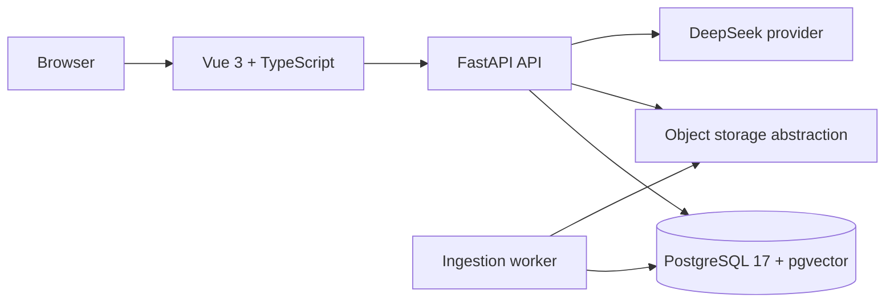

# Enterprise Knowledge RAG

一个面向企业内部文档的可解释、可评测知识库问答系统。系统覆盖文档上传与版本化、异步解析、文本分块、
向量与关键词混合检索、DeepSeek 带引用回答、资料不足拒答、资源权限、审计、监控和持续交付。

[](https://github.com/Bocch73/enterprise-knowledge-rag/actions/workflows/ci.yml)

> 当前状态：主分支已通过 GitHub Actions 远程质量门禁，包括后端、前端、浏览器流程、确定性 RAG 评测和
> 前后端容器镜像构建。项目尚未部署到生产服务器，当前结果不代表真实企业流量或高可用能力。

[系统架构](docs/architecture/system-architecture.md) ·
[数据模型](docs/architecture/data-model.md) ·
[质量评测](docs/11-quality-evaluation.md) ·
[部署运行手册](docs/operations/deployment-runbook.md)

## 核心亮点

- **完整文档链路**：文件校验、不可变版本、本地对象存储、持久摄取任务、解析、分块、向量写入和失败重试。
- **混合检索**：结合 PostgreSQL 全文检索与 pgvector 向量检索，通过倒数排名融合合并不同分数空间的结果。
- **可追溯回答**：DeepSeek 只接收检索上下文；服务端校验引用编号，资料不足或引用无效时拒答。
- **权限与审计**：全局角色和知识库资源角色共同限制数据访问，关键操作写入结构化审计事件。
- **可替换提供者**：向量与生成能力通过小型接口隔离，测试使用确定性实现，不依赖外部密钥和付费额度。
- **质量闭环**：固定语料、版本化问题集、检索指标、引用指标、拒答指标和自动质量门禁形成可重复证据。
- **运行保护**：分级限流、向量缓存、请求编号、健康检查、Prometheus 指标和管理员任务查询。
- **持续交付**：真实 PostgreSQL 与 pgvector 集成测试、浏览器验收、RAG 门禁、非根容器构建和版本镜像发布流程。

## 质量证据

| 范围 | 当前结果 | 结论边界 |
|---|---:|---|
| 后端测试 | 106 个测试通过，分支覆盖率 83.26% | 本地 PostgreSQL 17 测试基线 |
| 前端测试 | 12 个单元测试、2 个 Chrome 浏览器流程通过 | 使用隔离的浏览器模拟接口 |
| 确定性 RAG | Top 3 命中率、平均倒数排名、归一化折损累计增益均为 1.000 | 3 份虚构文档、5 个固定问题 |
| 部署资产 | 17 个专项测试及 YAML 格式检查通过 | 不等同于生产部署 |
| 远程流水线 | 后端、前端、RAG 和两个容器镜像构建全部成功 | 镜像仅构建，未发布或上线 |

评测集规模较小，当前数字用于回归检测和验证评测流程，不能解释成任意企业语料上的总体准确率。原始报告位于
[evaluation/reports](evaluation/reports)，指标定义与实验方法见[质量评测文档](docs/11-quality-evaluation.md)。

## 产品界面

产品页面与截图将在后续版本更新。当前仓库以可运行功能、自动化测试和评测报告作为主要验证证据。

## 系统架构



后端采用模块化单体：身份、知识库、文档、摄取、索引、检索、回答、评测、审计和运行保护位于同一代码库，
但保持清晰模块边界。网络接口和后台工作进程共享业务模块，分别独立运行。详细职责和数据流见
[系统架构](docs/architecture/system-architecture.md)。

## 快速开始

### 1. 环境要求

- Python 3.11
- PostgreSQL 17
- pgvector 0.8.6
- Node.js 24.19.0

本地开发不强制安装 Docker。PostgreSQL 与 pgvector 安装、数据库创建和环境检查见
[开发环境说明](docs/02-development-environment.md)与[数据库权限教程](docs/05-database-and-authorization.md)。

### 2. 配置并启动后端

```powershell
cd backend
Copy-Item .env.example .env
py -3.11 -m venv .venv
.\.venv\Scripts\python.exe -m pip install -r requirements-dev.lock
.\.venv\Scripts\python.exe -m alembic upgrade head
.\.venv\Scripts\python.exe -m app.server --reload
```

在 `backend/.env` 中填写本地数据库连接和应用密钥。使用 DeepSeek 时，再在被 Git 忽略的本地配置中填写
接口密钥；不要把真实密钥提交到仓库。

启动后可访问：

- 接口文档：<http://127.0.0.1:8000/docs>
- 存活检查：<http://127.0.0.1:8000/api/v1/health/live>
- 就绪检查：<http://127.0.0.1:8000/api/v1/health/ready>

### 3. 启动文档工作进程

在第二个终端运行：

```powershell
cd backend
.\.venv\Scripts\python.exe -m app.cli.run_ingestion_worker
```

工作进程持续领取 PostgreSQL 中的摄取任务，完成文档解析、分块与索引。上传接口不会在网络请求内执行整个
耗时流程。

### 4. 启动前端

在第三个终端运行：

```powershell
cd frontend
Copy-Item .env.example .env
npm ci
npm run dev
```

浏览器访问 <http://127.0.0.1:5173>。

## 技术栈

- **后端**：Python 3.11、FastAPI、SQLAlchemy 2、Alembic、Pydantic
- **数据与检索**：PostgreSQL 17、pgvector、PostgreSQL 全文检索、倒数排名融合
- **模型**：DeepSeek 生成提供者、确定性测试向量与生成提供者
- **文档处理**：pypdf、python-docx、Markdown 文本解析
- **前端**：Vue 3、TypeScript、Vite、Pinia、Vue Router
- **测试**：Pytest、Vitest、Playwright、Ruff、Mypy、覆盖率门禁
- **交付**：GitHub Actions、Docker、Docker Compose、Nginx、Dependabot

## 主要接口

- `POST /api/v1/auth/register`：注册账号
- `POST /api/v1/auth/login`：登录并获取访问令牌
- `GET /api/v1/auth/me`：读取当前用户
- `/api/v1/knowledge-bases`：知识库创建、查询与成员权限
- `POST /api/v1/knowledge-bases/{id}/documents`：上传文档
- `/api/v1/ingestion-jobs`：查看和重试摄取任务
- `GET /api/v1/documents/versions/{version_id}/chunks`：查看版本片段
- `POST /api/v1/knowledge-bases/{id}/search`：执行混合检索
- `POST /api/v1/knowledge-bases/{id}/answers`：生成带引用回答
- `POST /api/v1/knowledge-bases/{id}/answers/stream`：返回校验后的事件流
- `GET /api/v1/admin/audit-events`：管理员查询审计事件
- `GET /metrics`：Prometheus 指标

接口的身份、角色和资源边界见[数据库与权限说明](docs/05-database-and-authorization.md)，回答与引用规则见
[带引用问答说明](docs/09-grounded-answers.md)。

## 项目结构

```text
enterprise-knowledge-rag/
├── backend/       FastAPI 应用、数据库迁移、工作进程和后端测试
├── frontend/      Vue 工作台、单元测试和浏览器流程
├── evaluation/    固定评测集、虚构语料和版本化实验报告
├── deploy/        生产式 Compose、密钥模板和数据库初始化
├── docs/          需求、架构、实现、质量和运行文档
├── scripts/       环境、测试、评测、备份和恢复脚本
└── .github/       持续集成、版本发布和依赖更新配置
```

## 验证

### 后端质量门禁

```powershell
powershell -ExecutionPolicy Bypass -File .\scripts\verify-backend.ps1
```

### 前端质量门禁

```powershell
powershell -ExecutionPolicy Bypass -File .\scripts\verify-frontend.ps1 -EndToEnd
```

### 确定性 RAG 评测

```powershell
powershell -ExecutionPolicy Bypass -File .\scripts\run-reference-evaluation.ps1 `
  -Mode full `
  -GenerationProvider deterministic
```

这个命令只使用仓库中的虚构文档，不调用 DeepSeek，也不会产生模型费用。

### 部署资产检查

```powershell
powershell -ExecutionPolicy Bypass -File .\scripts\verify-deployment.ps1
```

## 部署与当前边界

`deploy/compose.production.yml` 提供 PostgreSQL、独立迁移、后端、持续工作进程和 Nginx 前端的单机生产式
拓扑，并使用文件型密钥、内部数据库网络、非根用户、只读文件系统、健康检查和日志轮转。完整步骤见
[部署运行手册](docs/operations/deployment-runbook.md)。

当前仍有以下边界：

- 没有真实生产服务器、公网 HTTPS 或生产流量证据。
- 单进程限流和缓存尚未迁移到 Redis 等共享组件。
- PostgreSQL 任务轮询适合当前规模，不代表高吞吐消息队列能力。
- 备份与恢复脚本已经提供，但必须在隔离环境完成真实恢复演练后才能形成恢复证据。
- 确定性测试提供者用于自动化验证，不代表真实语义模型效果。

## 文档

- [学习与开发路线](docs/00-learning-roadmap.md)
- [项目章程](docs/01-project-charter.md)
- [功能需求](docs/requirements/functional-requirements.md)
- [非功能需求](docs/requirements/non-functional-requirements.md)
- [需求追踪矩阵](docs/requirements/traceability-matrix.md)
- [系统架构](docs/architecture/system-architecture.md)
- [架构决策记录](docs/architecture/decisions/README.md)
- [备份与恢复](docs/operations/backup-and-restore.md)
- [发布检查清单](docs/operations/release-checklist.md)
- [贡献指南](CONTRIBUTING.md)
