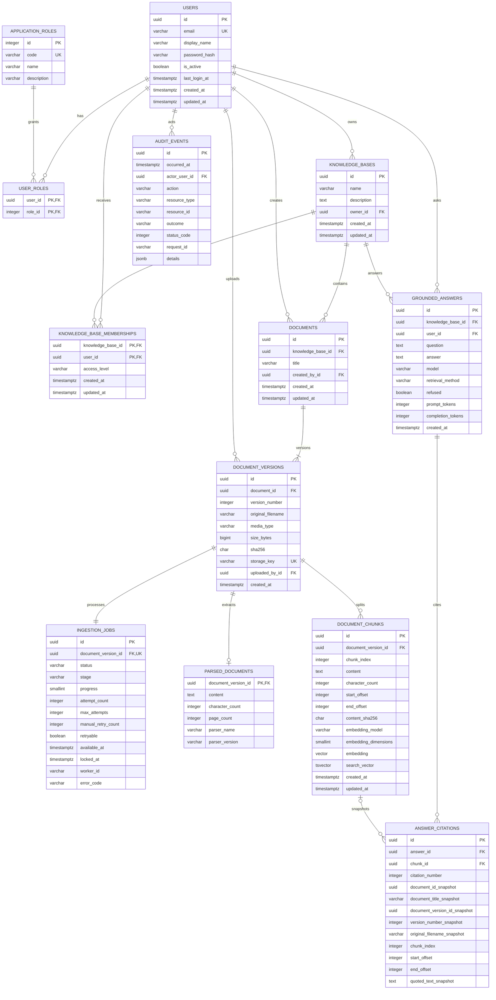

# 第 12 步数据模型

## 两层权限

- `application_roles` 与 `user_roles` 表达整个应用范围的角色，目前有 `admin` 和 `member`。
- `knowledge_base_memberships` 表达单个知识库范围的权限，目前有 `owner`、`editor` 和 `viewer`。

一个用户是全局管理员，不代表默认读取全部知识库内容。内容访问仍通过知识库成员关系过滤，这符合最小权限原则。管理员可以执行全局用户管理，并在必要时管理成员关系，但普通列表查询不会自动泄露所有知识库。

## 关键约束

- 邮箱写入前转换为小写，数据库还使用 `lower(email)` 唯一索引防止并发绕过。
- 知识库所有者使用限制删除，避免删除用户后留下无主知识库。
- 用户角色和知识库成员关系使用级联删除，避免孤立关联记录。
- 知识库编号与用户编号组成成员表的复合主键，因此同一用户在同一知识库只有一条权限记录。
- `access_level` 使用数据库检查约束，只允许三个已定义值。
- 一个逻辑文档的版本号唯一，同一内容指纹不能成为该文档的重复版本。
- 一个文档版本最多有一个摄取任务和一份有效解析文本，形成数据库级幂等防线。
- 一个文档版本可以有多个有序片段，但版本编号与片段序号组合必须唯一。
- 片段向量固定为 `vector(384)`，同时保存模型标识和维度，错误维度不能写入。
- 片段保存原文起止位置和 SHA-256 指纹，重复处理使用稳定编号并原子替换完整集合。
- `search_vector` 是从片段原文自动计算的存储生成列，并使用广义倒排索引加速关键词检索。
- 状态、阶段、进度、尝试次数和人工重试次数都有检查约束，非法状态不能写入数据库。
- 任务调度索引覆盖状态、可执行时间和创建时间，服务于多工作进程领取任务。
- 删除知识库会级联删除文档、版本、任务和解析文本；删除用户受文档创建者和上传者外键限制。
- 每个回答保存调用者、模型、检索方式、拒答状态和可选词元用量。
- 每个回答的引用编号唯一且为正数，片段位置必须满足有效区间约束。
- 删除片段时引用的 `chunk_id` 设为空，但生成时来源快照仍保留；删除回答时引用级联删除。
- 审计事件的操作者可以为空，用于记录尚未确认身份的失败登录；删除用户时保留事件并把操作者设为空。
- 审计结果和网络状态码有数据库检查约束，查询索引覆盖时间、操作者、操作和资源。
- 应用只提供审计新增与管理员查询，不提供更新或删除接口；数据库高权限仍需另行控制。

## 文档与版本为什么分表

`documents` 表示业务概念，例如“员工手册”；`document_versions` 表示某次具体上传。标题可以属于逻辑文档，而文件名、大小、指纹、对象键和解析结果属于某个确定版本。这样版本 2 上线后，版本 1 仍能支撑历史答案引用和审计复现。

对象存储键只保存在后端数据库，不通过公共接口返回。应用根据文档和知识库成员关系完成权限检查后，才能读取对应对象。
