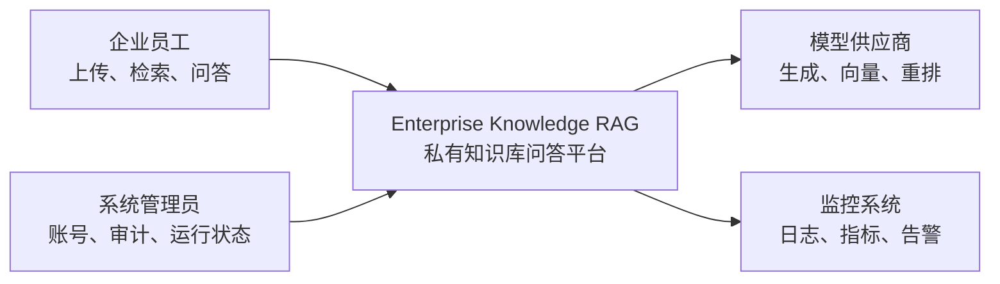
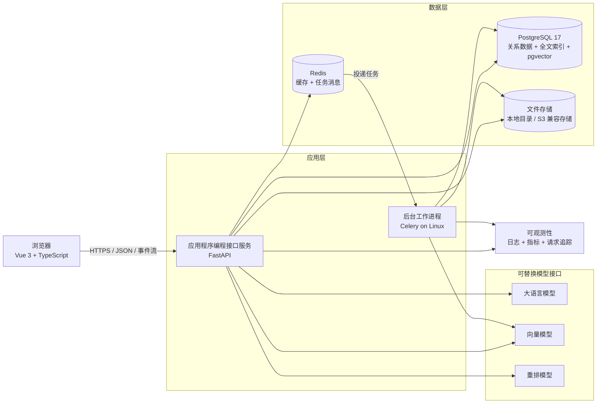
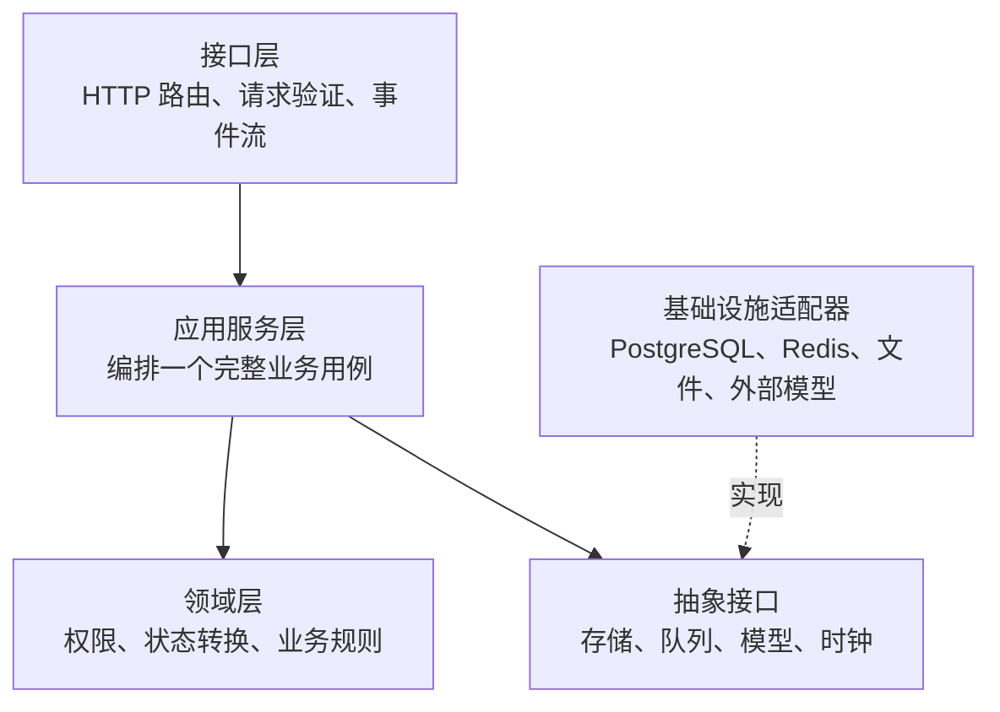
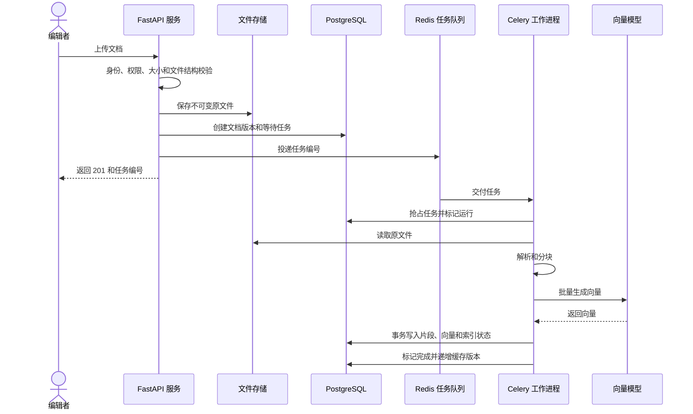
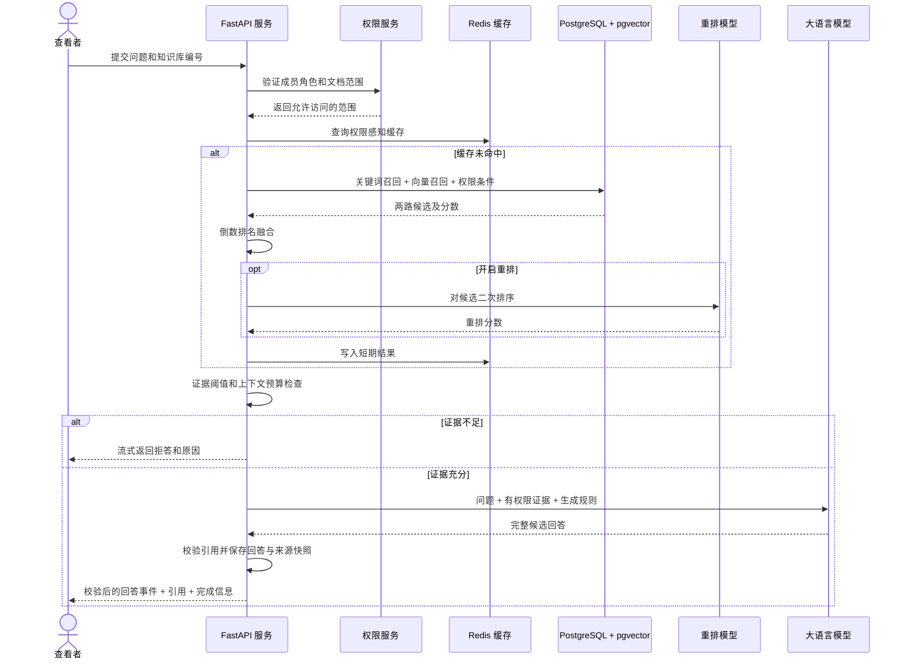

# 系统总体架构

## 1. 架构目标

本架构优先保证以下事情：

1. 用户权限在检索和模型调用之前生效。
2. 文档上传、解析、索引和问答全过程可追踪。
3. 数据库、缓存和模型供应商可以替换，但业务规则不被基础设施绑死。
4. 个人能够完成第一版，同时保留真实企业系统需要的测试、安全和部署边界。
5. 先形成模块化单体，只有出现独立扩展需求后才拆分微服务。

## 2. 系统上下文

系统上下文图只说明系统与哪些人或外部系统交互，不展示内部代码细节。

## 3. 可部署单元与基础设施

- **HTTPS** 是加密的超文本传输协议，用于保护浏览器和服务器之间的数据。
- **JSON** 是结构化文本数据格式，用于接口交换数据。
- **事件流**允许服务器在一次长连接中逐步发送回答，而不是等全部生成后一次返回。
- **S3 兼容存储**是遵循 Amazon Simple Storage Service 接口习惯的对象存储，适合保存大量原文件；第一版本地开发先使用本地目录。

## 4. 唯一可信来源

**唯一可信来源**（Source of Truth）是发生冲突时被视为最终正确的数据位置。

| 数据 | 唯一可信来源 | 是否可以重建 |
|---|---|---|
| 用户、角色、知识库、文档版本 | PostgreSQL | 依赖数据库备份恢复 |
| 文档片段、向量、全文索引 | PostgreSQL | 可以从不可变原文件和配置重建 |
| 原始上传文件 | 文件存储 | 依赖文件备份恢复 |
| 检索缓存 | Redis | 可以直接丢弃并重新计算 |
| 任务消息 | Redis | 数据库任务记录用于对账和重新投递 |
| 模型调用记录和引用快照 | PostgreSQL | 作为审计证据保留 |

Redis 不能成为文档任务状态的唯一记录。消息可能重复、过期或丢失，因此数据库必须保存任务编号、阶段、尝试次数和最终状态。

## 5. 后端模块边界

“依赖倒置”表示核心业务依赖抽象接口，而 PostgreSQL、Redis 和模型供应商去实现这些接口。这样测试可以换成本地替身，业务逻辑不会到处出现供应商专用代码。

当前业务模块与演进边界：

| 模块 | 主要职责 | 明确不负责 |
|---|---|---|
| `identity` | 用户、密码、访问凭证、账号状态 | 知识库成员角色 |
| `knowledge_base` | 知识库、成员、角色和文档可见性 | 文档内容解析 |
| `document` | 原文件、不可变版本、文件校验 | 向量检索排序 |
| `ingestion` | 任务状态、解析、分块、向量和索引编排 | 用户登录 |
| `retrieval` | 权限过滤、关键词和向量召回、融合、重排 | 生成自然语言答案 |
| `chat` | 会话、上下文、拒答、生成、引用校验 | 建立文档索引 |
| `evaluation` | 数据集、实验配置、逐题结果和报告 | 修改线上业务数据 |
| `audit` | 关键身份、权限、文档与任务操作的持久证据 | 充当普通调试日志或保存敏感正文 |
| `operations` | 健康检查、限流、向量缓存、指标和管理员运行状态 | 业务规则 |

模块之间通过应用服务或公开接口协作，不能直接修改其他模块的内部表和对象。

## 6. 文档摄取数据流

关键规则：

1. 文件先安全落盘，任务才进入队列。
2. 队列只传任务编号，不传完整文档和密钥。
3. 任务必须幂等，因为消息系统可能重复投递。
4. 文档解析错误属于永久错误，不自动无限重试；模型超时可能属于暂时错误。
5. 新索引全部成功后再切换为可检索状态，避免用户读到半成品。

第 6 步在不安装 Docker 的 Windows 环境中已经实现数据库持久任务和独立工作进程边界，但暂未接入图中的 Redis 与 Celery。当前工作命令使用 PostgreSQL 行锁领取任务；正式 Linux 部署时由 Redis 负责消息通知、Celery 负责持续执行，数据库任务记录仍作为最终可追踪状态。具体过渡方案见 [ADR-0005](decisions/0005-asynchronous-ingestion.md)。

## 7. 检索和问答数据流

第 9 步采用校验后流式输出：外部模型先返回完整候选回答，应用验证引用并完成数据库事务，之后才发送服务器事件。它牺牲首个事件延迟，换取不向客户端展示未校验答案。上游逐词元流式仍是后续优化项。

**倒数排名融合**（Reciprocal Rank Fusion）按照候选在各结果列表中的名次计算融合分数，常简称 RRF。它不要求关键词分数和向量分数处在相同数值范围。

权限感知缓存的键必须包含用户可见范围或权限版本。否则 Alice 的缓存结果可能错误返回给 Bob，造成数据泄露。

第 12 步当前只缓存文本到向量的纯计算结果，不缓存图中的权限感知检索结果。缓存与限流暂时位于单个
Python 进程中；图中的 Redis 是两个以上实例和正式任务队列的生产目标。详细权衡见
[ADR-0006](decisions/0006-runtime-hardening.md)。

## 8. 计划接口边界

接口统一以 `/api/v1` 开头。`v1` 表示第一代公开接口，以后发生不兼容变化时可以新增版本而不是突然破坏现有客户端。

| 领域 | 计划入口 |
|---|---|
| 健康检查 | `/health/live`、`/health/ready` |
| 身份 | `/auth/register`、`/auth/login`、`/auth/me` |
| 知识库 | `/knowledge-bases`、`/knowledge-bases/{id}` |
| 成员 | `/knowledge-bases/{id}/members` |
| 文档 | `/knowledge-bases/{id}/documents`、`/documents/{id}` |
| 摄取任务 | `/ingestion-jobs/{id}`、`/ingestion-jobs/{id}/retry` |
| 检索 | `/knowledge-bases/{id}/search` |
| 问答 | `/knowledge-bases/{id}/answers`、`/knowledge-bases/{id}/answers/stream` |
| 会话 | `/conversations/{id}/messages` |
| 评测 | `/evaluations`、`/evaluations/{id}` |
| 审计 | `/audit-events` |
| 运行指标 | 根路径 `/metrics` |
| 管理员任务队列 | `/admin/ingestion-jobs` |

接口详细字段会在实现相应模块时通过 OpenAPI 文档确定。

## 9. 安全边界

1. 浏览器输入永远不可信，接口层先完成结构和长度验证。
2. 访问凭证只证明用户身份，业务服务仍需检查知识库和文档权限。
3. 文件解析器处理不可信二进制内容，应限制大小、压缩比、解析时间和输出长度。
4. 模型供应商属于外部信任边界，只发送最小必要资料，不发送密码和无关文档。
5. 日志与监控系统不能记录完整访问凭证、密钥或敏感文档正文。
6. 管理员不是默认可以绕过所有审计；高权限操作仍必须留痕。

## 10. 开发与部署阶段

| 阶段 | 运行方式 | 当前要求 |
|---|---|---|
| 第 3 步 | 只有文档 | 不需要数据库或 Docker |
| 第 4 步 | Windows + Python 虚拟环境 | 使用本地配置和测试替身，不需要 Docker |
| 第 5 步 | PostgreSQL 本机安装或容器 | 开始数据库迁移和真实集成测试 |
| 第 6 步本地过渡 | PostgreSQL + 数据库轮询工作命令 | Windows 可运行，不需要 Docker；仅用于学习和小规模演示 |
| 第 7 至 12 步本地学习链路 | PostgreSQL + 数据库轮询工作命令 + 进程内缓存与限流 | Windows 可运行，不要求 Docker |
| 第 13 步单机生产式链路 | Linux 容器 + PostgreSQL 任务轮询 + Nginx + 持久卷 | 配置与静态检查已完成；本机 Docker 仍可延期 |
| 多实例正式交付 | Linux 容器 + Redis + Celery + 共享对象存储 | 健康检查、备份、监控、非根用户和共享运行状态；仍是下一阶段生产升级 |

**反向代理**是位于浏览器和应用服务之间的入口服务器，负责加密连接、转发请求、静态文件和部分安全策略。**持久卷**是容器删除或重建后仍保留数据库与文件的数据空间。

## 11. 已知架构风险

| 风险 | 当前控制 |
|---|---|
| Windows 原生不受 Celery 官方支持 | 工作进程只在 Linux、WSL 2 或 Linux 容器运行；早期使用同步测试路径。 |
| PostgreSQL 本机安装 pgvector 较复杂 | 第 5 步比较本机安装和容器方案，再执行可验证安装。 |
| 外部模型不稳定或收费 | Provider 抽象、本地确定性替身、超时、有限重试和成本记录。 |
| 近似向量索引可能漏掉相关结果 | 评测中与精确检索对比召回率，数据规模小时先使用精确检索。 |
| 模块化单体逐渐耦合 | 模块公开接口、依赖方向、架构测试和决策记录。 |
| 单进程限流和缓存无法跨实例共享 | 多实例部署前迁移到 Redis；当前配置明确标为本地过渡实现。 |
| 指标标签导致监控基数爆炸或泄露 | 只允许受控路由模板、方法、状态和供应商标签，不使用业务编号或正文。 |
| 流水线与发布路径质量标准漂移 | 普通持续集成和版本发布调用同一份可复用质量门禁。 |
| 数据库迁移失败后应用继续启动 | 独立一次性迁移服务；只有迁移成功才启动接口与工作进程。 |
| 镜像或密钥无法追溯 | 版本标签、代码修订、软件物料清单、来源证明和文件型密钥；生产记录镜像摘要。 |
